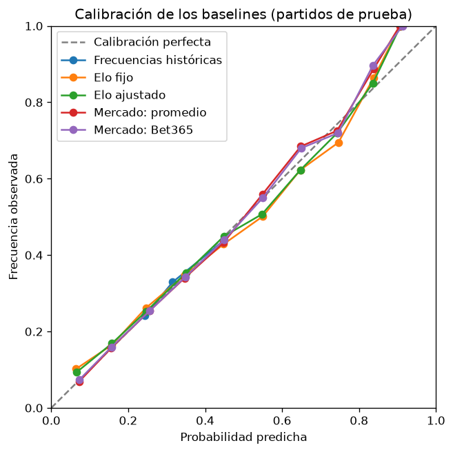

# Baselines: resultado 1X2 de la Premier League

Generado por `python scripts/evaluate_baselines.py`. No editar a mano.

- **Datos:** 4180 partidos, temporadas 2015/16 a 2025/26.
- **División temporal (ventana expansiva):** se entrena con todas las temporadas hasta N y se prueba en la N+1. La primera prueba usa 3 temporadas de entrenamiento.
- **Temporadas de prueba:** 2018/19 a 2025/26 (8 temporadas, 3040 partidos).
- **Elo fijo:** K = 20, ventaja de local = 60 puntos, sin ajustar.
- **Elo ajustado:** en cada ventana se prueban 30 combinaciones (K en [10, 15, 20, 25, 30, 40], ventaja de local en [0, 30, 60, 90, 120]) y se elige la de menor log loss promedio al repetir la ventana expansiva dentro del entrenamiento (ajustar con las primeras temporadas, validar en la siguiente). La temporada de prueba no interviene en la elección.
- **Mercado:** probabilidades implícitas de las cuotas con el margen removido (normalización proporcional).
- En las tres métricas, menos es mejor.
- **Limitaciones:** todos los equipos empiezan con el mismo Elo en la primera temporada, así que los primeros partidos de entrenamiento aportan diferencias poco informativas.

## Global (los 3040 partidos de prueba juntos)

| Modelo | Log loss | Brier | RPS |
|---|---|---|---|
| Frecuencias históricas | 1.0675 | 0.6461 | 0.2342 |
| Elo fijo | 0.9786 | 0.5807 | 0.2025 |
| Elo ajustado | 0.9777 | 0.5807 | 0.2024 |
| Mercado: promedio | 0.9584 | 0.5680 | 0.1965 |
| Mercado: Bet365 | 0.9594 | 0.5683 | 0.1966 |

## Parámetros del Elo elegidos en cada ventana

| Temporada de prueba | Temporadas de validación | K | Ventaja de local |
|---|---|---|---|
| 2018/19 | 2 | 40 | 90 |
| 2019/20 | 3 | 30 | 90 |
| 2020/21 | 4 | 30 | 0 |
| 2021/22 | 5 | 30 | 0 |
| 2022/23 | 6 | 30 | 0 |
| 2023/24 | 7 | 30 | 30 |
| 2024/25 | 8 | 30 | 60 |
| 2025/26 | 9 | 30 | 60 |

## Log loss por temporada de prueba

| Temporada de prueba | Frecuencias históricas | Elo fijo | Elo ajustado | Mercado: promedio | Mercado: Bet365 |
|---|---|---|---|---|---|
| 2018/19 | 1.0469 | 0.9061 | 0.9105 | 0.8936 | 0.8929 |
| 2019/20 | 1.0645 | 0.9852 | 0.9819 | 0.9726 | 0.9732 |
| 2020/21 | 1.0890 | 1.0506 | 1.0496 | 1.0042 | 1.0070 |
| 2021/22 | 1.0695 | 0.9524 | 0.9579 | 0.9360 | 0.9372 |
| 2022/23 | 1.0510 | 0.9841 | 0.9753 | 0.9658 | 0.9662 |
| 2023/24 | 1.0540 | 0.9261 | 0.9295 | 0.9093 | 0.9092 |
| 2024/25 | 1.0811 | 0.9830 | 0.9777 | 0.9706 | 0.9708 |
| 2025/26 | 1.0838 | 1.0415 | 1.0389 | 1.0153 | 1.0185 |

## Brier por temporada de prueba

| Temporada de prueba | Frecuencias históricas | Elo fijo | Elo ajustado | Mercado: promedio | Mercado: Bet365 |
|---|---|---|---|---|---|
| 2018/19 | 0.6318 | 0.5285 | 0.5330 | 0.5223 | 0.5221 |
| 2019/20 | 0.6434 | 0.5854 | 0.5838 | 0.5750 | 0.5750 |
| 2020/21 | 0.6630 | 0.6195 | 0.6212 | 0.5968 | 0.5982 |
| 2021/22 | 0.6478 | 0.5640 | 0.5678 | 0.5537 | 0.5540 |
| 2022/23 | 0.6339 | 0.5855 | 0.5804 | 0.5737 | 0.5735 |
| 2023/24 | 0.6371 | 0.5455 | 0.5480 | 0.5331 | 0.5331 |
| 2024/25 | 0.6557 | 0.5880 | 0.5842 | 0.5789 | 0.5787 |
| 2025/26 | 0.6558 | 0.6290 | 0.6269 | 0.6100 | 0.6115 |

## RPS por temporada de prueba

| Temporada de prueba | Frecuencias históricas | Elo fijo | Elo ajustado | Mercado: promedio | Mercado: Bet365 |
|---|---|---|---|---|---|
| 2018/19 | 0.2377 | 0.1892 | 0.1907 | 0.1858 | 0.1857 |
| 2019/20 | 0.2299 | 0.2029 | 0.2021 | 0.1987 | 0.1988 |
| 2020/21 | 0.2459 | 0.2240 | 0.2249 | 0.2131 | 0.2137 |
| 2021/22 | 0.2349 | 0.1944 | 0.1960 | 0.1890 | 0.1890 |
| 2022/23 | 0.2287 | 0.2046 | 0.2019 | 0.1991 | 0.1990 |
| 2023/24 | 0.2338 | 0.1895 | 0.1904 | 0.1838 | 0.1839 |
| 2024/25 | 0.2354 | 0.2017 | 0.1999 | 0.1974 | 0.1972 |
| 2025/26 | 0.2277 | 0.2138 | 0.2129 | 0.2053 | 0.2057 |

## Calibración

Se juntan las tres probabilidades de cada partido (local, empate, visitante) y se agrupan en tramos de 10 puntos. `predicho` es la probabilidad promedio que dio el modelo en el tramo; `observado` es la frecuencia con la que ese resultado ocurrió. Un modelo bien calibrado tiene ambos valores parecidos. Los tramos con pocos casos (`n` bajo) son ruidosos.

### Frecuencias históricas

| Tramo | n | predicho | observado |
|---|---|---|---|
| 0.2 a 0.3 | 3420 | 0.2434 | 0.2421 |
| 0.3 a 0.4 | 2660 | 0.3156 | 0.3293 |
| 0.4 a 0.5 | 3040 | 0.4500 | 0.4395 |

### Elo fijo

| Tramo | n | predicho | observado |
|---|---|---|---|
| 0.0 a 0.1 | 539 | 0.0644 | 0.1020 |
| 0.1 a 0.2 | 1475 | 0.1574 | 0.1647 |
| 0.2 a 0.3 | 3387 | 0.2461 | 0.2616 |
| 0.3 a 0.4 | 954 | 0.3479 | 0.3480 |
| 0.4 a 0.5 | 894 | 0.4475 | 0.4284 |
| 0.5 a 0.6 | 730 | 0.5497 | 0.5014 |
| 0.6 a 0.7 | 594 | 0.6474 | 0.6229 |
| 0.7 a 0.8 | 403 | 0.7464 | 0.6948 |
| 0.8 a 0.9 | 139 | 0.8375 | 0.8633 |
| 0.9 a 1.0 | 5 | 0.9072 | 1.0000 |

### Elo ajustado

| Tramo | n | predicho | observado |
|---|---|---|---|
| 0.0 a 0.1 | 458 | 0.0664 | 0.0939 |
| 0.1 a 0.2 | 1416 | 0.1577 | 0.1688 |
| 0.2 a 0.3 | 3528 | 0.2467 | 0.2526 |
| 0.3 a 0.4 | 977 | 0.3498 | 0.3531 |
| 0.4 a 0.5 | 904 | 0.4486 | 0.4491 |
| 0.5 a 0.6 | 771 | 0.5478 | 0.5071 |
| 0.6 a 0.7 | 594 | 0.6475 | 0.6229 |
| 0.7 a 0.8 | 356 | 0.7427 | 0.7191 |
| 0.8 a 0.9 | 113 | 0.8357 | 0.8496 |
| 0.9 a 1.0 | 3 | 0.9079 | 1.0000 |

### Mercado: promedio

| Tramo | n | predicho | observado |
|---|---|---|---|
| 0.0 a 0.1 | 379 | 0.0720 | 0.0686 |
| 0.1 a 0.2 | 1478 | 0.1559 | 0.1570 |
| 0.2 a 0.3 | 3407 | 0.2552 | 0.2539 |
| 0.3 a 0.4 | 1306 | 0.3466 | 0.3400 |
| 0.4 a 0.5 | 902 | 0.4475 | 0.4324 |
| 0.5 a 0.6 | 702 | 0.5495 | 0.5598 |
| 0.6 a 0.7 | 485 | 0.6485 | 0.6845 |
| 0.7 a 0.8 | 317 | 0.7428 | 0.7256 |
| 0.8 a 0.9 | 142 | 0.8379 | 0.8873 |
| 0.9 a 1.0 | 2 | 0.9058 | 1.0000 |

### Mercado: Bet365

| Tramo | n | predicho | observado |
|---|---|---|---|
| 0.0 a 0.1 | 391 | 0.0734 | 0.0742 |
| 0.1 a 0.2 | 1512 | 0.1565 | 0.1594 |
| 0.2 a 0.3 | 3424 | 0.2557 | 0.2538 |
| 0.3 a 0.4 | 1233 | 0.3485 | 0.3431 |
| 0.4 a 0.5 | 903 | 0.4493 | 0.4396 |
| 0.5 a 0.6 | 691 | 0.5498 | 0.5499 |
| 0.6 a 0.7 | 522 | 0.6498 | 0.6801 |
| 0.7 a 0.8 | 296 | 0.7453 | 0.7196 |
| 0.8 a 0.9 | 146 | 0.8365 | 0.8973 |
| 0.9 a 1.0 | 2 | 0.9128 | 1.0000 |
