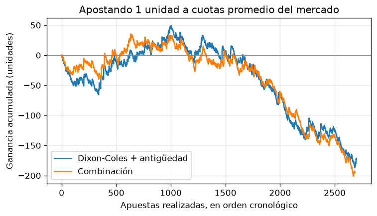

# ¿Sirve el modelo para apostar?

Generado por `python scripts/evaluate_models.py`. No editar a mano.

Simulación sobre los 3040 partidos de prueba de 8 temporadas. Las probabilidades de cada partido son las de la evaluación: fuera de muestra y calculadas solo con información anterior al partido.

- **Estrategia:** 1 unidad por partido, al resultado con mayor valor esperado según el modelo (probabilidad × cuota − 1), solo si ese valor supera la ventaja mínima. Ganancia: cuota − 1 si acierta, −1 si no.
- **Cuotas:** las publicadas antes del partido por football-data.co.uk, no las de cierre. "Mejor cuota del mercado" es la más alta entre todas las casas en cada resultado: en la práctica casi nunca se consigue siempre, así que es un límite optimista.
- **No incluye** comisiones, límites de apuesta ni cuentas restringidas por ganar.
- **ROI:** ganancia media por unidad apostada. El error estándar indica cuánto puede variar por azar.
- No es una estrategia recomendada ni consejo de apuestas: sirve para medir si el modelo tiene ventaja sobre el mercado.

| Modelo | Cuotas | Ventaja mínima | Apuestas | Aciertos | ROI | Error estándar | Temporadas en positivo |
|---|---|---|---|---|---|---|---|
| Dixon-Coles + antigüedad | Promedio del mercado | 0% | 2699 | 25.7% | -6.4% | 3.8% | 2 de 8 |
| Dixon-Coles + antigüedad | Promedio del mercado | 5% | 2168 | 23.3% | -6.6% | 4.5% | 2 de 8 |
| Dixon-Coles + antigüedad | Promedio del mercado | 10% | 1745 | 21.0% | -6.9% | 5.3% | 2 de 8 |
| Dixon-Coles + antigüedad | Bet365 | 0% | 2662 | 25.6% | -3.5% | 4.0% | 2 de 8 |
| Dixon-Coles + antigüedad | Bet365 | 5% | 2138 | 23.3% | -2.8% | 4.7% | 2 de 8 |
| Dixon-Coles + antigüedad | Bet365 | 10% | 1705 | 21.5% | -1.8% | 5.5% | 2 de 8 |
| Dixon-Coles + antigüedad | Mejor cuota del mercado | 0% | 3018 | 26.4% | -0.3% | 4.0% | 2 de 8 |
| Dixon-Coles + antigüedad | Mejor cuota del mercado | 5% | 2638 | 24.5% | -0.1% | 4.4% | 2 de 8 |
| Dixon-Coles + antigüedad | Mejor cuota del mercado | 10% | 2173 | 22.1% | -0.7% | 5.2% | 3 de 8 |
| Combinación | Promedio del mercado | 0% | 2685 | 27.5% | -7.3% | 3.7% | 2 de 8 |
| Combinación | Promedio del mercado | 5% | 2074 | 24.6% | -8.0% | 4.5% | 1 de 8 |
| Combinación | Promedio del mercado | 10% | 1566 | 22.7% | -5.6% | 5.6% | 2 de 8 |
| Combinación | Bet365 | 0% | 2610 | 27.6% | -3.4% | 3.9% | 2 de 8 |
| Combinación | Bet365 | 5% | 2029 | 24.9% | -3.0% | 4.7% | 2 de 8 |
| Combinación | Bet365 | 10% | 1522 | 22.3% | -4.6% | 5.7% | 2 de 8 |
| Combinación | Mejor cuota del mercado | 0% | 3020 | 28.0% | -0.2% | 3.9% | 4 de 8 |
| Combinación | Mejor cuota del mercado | 5% | 2613 | 26.0% | -0.8% | 4.4% | 3 de 8 |
| Combinación | Mejor cuota del mercado | 10% | 2059 | 23.6% | +1.4% | 5.3% | 3 de 8 |

