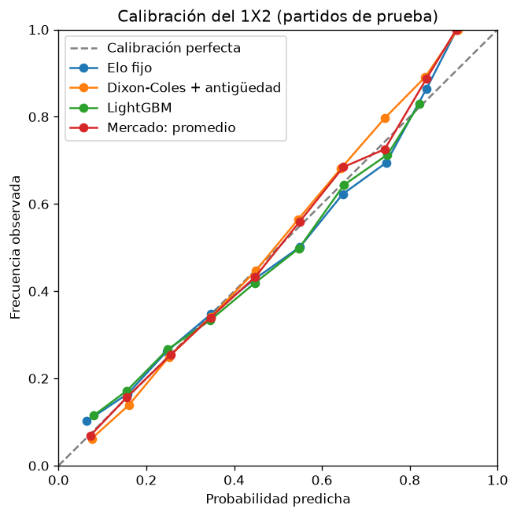

# Informe final: resultado 1X2 y goles de la Premier League

Generado por `python scripts/evaluate_models.py`. No editar a mano.

- **Datos:** 4180 partidos, temporadas 2015/16 a 2025/26.
- **División temporal (ventana expansiva):** se entrena con las temporadas hasta N y se prueba en la N+1. Temporadas de prueba: 2018/19 a 2025/26 (8 temporadas, 3040 partidos).
- **Elo fijo:** K = 20, ventaja de local = 60.
- **Modelos de goles:** penalización = 10, reajuste en cada fecha con los partidos anteriores. Dixon-Coles corrige los marcadores 0-0, 1-0, 0-1 y 1-1. El peso por antigüedad hace que un partido cuente la mitad cada vez que pasa una vida media; la vida media se elige en cada ventana, entre ['sin peso', 1095, 730, 365, 180] días, con el log loss de las temporadas de entrenamiento.
- **LightGBM:** 17 variables previas al partido: diferencia de Elo, goles esperados del modelo de goles, y forma de los últimos 5 partidos de cada equipo (puntos, goles, tiros a puerta, puntos en su condición de local o visitante, días de descanso). Hiperparámetros fijos, sin ajustar; semilla 0.
- **Mercado:** promedio de las casas, con el margen removido (normalización proporcional).
- En todas las métricas, menos es mejor.

## Resultado 1X2 (los 3040 partidos de prueba juntos)

| Modelo | Log loss | Brier | RPS |
|---|---|---|---|
| Frecuencias históricas | 1.0675 | 0.6461 | 0.2342 |
| Elo fijo | 0.9786 | 0.5807 | 0.2025 |
| Poisson | 0.9907 | 0.5899 | 0.2075 |
| Dixon-Coles | 0.9917 | 0.5904 | 0.2076 |
| Poisson + antigüedad | 0.9731 | 0.5779 | 0.2014 |
| Dixon-Coles + antigüedad | 0.9739 | 0.5783 | 0.2015 |
| LightGBM | 0.9808 | 0.5821 | 0.2028 |
| Mercado: promedio | 0.9584 | 0.5680 | 0.1965 |

## Más/menos de 2.5 goles (los 3040 partidos de prueba juntos)

| Modelo | Log loss | Brier |
|---|---|---|
| Frecuencia histórica | 0.6892 | 0.4960 |
| Poisson | 0.6841 | 0.4910 |
| Dixon-Coles | 0.6841 | 0.4910 |
| Poisson + antigüedad | 0.6822 | 0.4890 |
| Dixon-Coles + antigüedad | 0.6822 | 0.4890 |
| Mercado: promedio | 0.6755 | 0.4826 |

## Vida media elegida en cada ventana

| Temporada de prueba | Vida media elegida (días) |
|---|---|
| 2018/19 | 365 |
| 2019/20 | 365 |
| 2020/21 | 365 |
| 2021/22 | 365 |
| 2022/23 | 365 |
| 2023/24 | 365 |
| 2024/25 | 365 |
| 2025/26 | 365 |

## Log loss por temporada de prueba: 1X2

| Temporada de prueba | Frecuencias históricas | Elo fijo | Poisson | Dixon-Coles | Poisson + antigüedad | Dixon-Coles + antigüedad | LightGBM | Mercado: promedio |
|---|---|---|---|---|---|---|---|---|
| 2018/19 | 1.0469 | 0.9061 | 0.9032 | 0.9077 | 0.8985 | 0.9035 | 0.9010 | 0.8936 |
| 2019/20 | 1.0645 | 0.9852 | 0.9712 | 0.9713 | 0.9720 | 0.9723 | 0.9895 | 0.9726 |
| 2020/21 | 1.0890 | 1.0506 | 1.0256 | 1.0284 | 1.0136 | 1.0156 | 1.0327 | 1.0042 |
| 2021/22 | 1.0695 | 0.9524 | 0.9516 | 0.9517 | 0.9532 | 0.9532 | 0.9580 | 0.9360 |
| 2022/23 | 1.0510 | 0.9841 | 1.0188 | 1.0199 | 0.9937 | 0.9944 | 0.9912 | 0.9658 |
| 2023/24 | 1.0540 | 0.9261 | 0.9419 | 0.9424 | 0.9333 | 0.9328 | 0.9288 | 0.9093 |
| 2024/25 | 1.0811 | 0.9830 | 1.0552 | 1.0554 | 0.9933 | 0.9932 | 0.9978 | 0.9706 |
| 2025/26 | 1.0838 | 1.0415 | 1.0579 | 1.0568 | 1.0275 | 1.0261 | 1.0477 | 1.0153 |

## Log loss por temporada de prueba: más/menos de 2.5 goles

| Temporada de prueba | Frecuencia histórica | Poisson | Dixon-Coles | Poisson + antigüedad | Dixon-Coles + antigüedad | Mercado: promedio |
|---|---|---|---|---|---|---|
| 2018/19 | 0.6906 | 0.7003 | 0.7003 | 0.6970 | 0.6970 | 0.6846 |
| 2019/20 | 0.6924 | 0.6631 | 0.6631 | 0.6701 | 0.6701 | 0.6650 |
| 2020/21 | 0.6947 | 0.7008 | 0.7008 | 0.6966 | 0.6966 | 0.6910 |
| 2021/22 | 0.6906 | 0.6707 | 0.6707 | 0.6792 | 0.6792 | 0.6815 |
| 2022/23 | 0.6918 | 0.6819 | 0.6819 | 0.6759 | 0.6759 | 0.6692 |
| 2023/24 | 0.6793 | 0.6868 | 0.6868 | 0.6681 | 0.6681 | 0.6477 |
| 2024/25 | 0.6859 | 0.6868 | 0.6868 | 0.6796 | 0.6796 | 0.6774 |
| 2025/26 | 0.6883 | 0.6827 | 0.6827 | 0.6911 | 0.6911 | 0.6873 |

## Variables más importantes de LightGBM

Parte de la mejora total del modelo que aporta cada variable, promediada entre las ventanas.

| Variable | Importancia (ganancia) |
|---|---|
| elo_diff | 0.3693 |
| expected_goals_home | 0.2056 |
| expected_goals_away | 0.0766 |
| away_form_shots_for | 0.0679 |
| home_form_shots_for | 0.0675 |
| away_form_shots_against | 0.0372 |
| home_form_shots_against | 0.0320 |
| home_venue_points | 0.0303 |
| away_venue_points | 0.0217 |
| home_form_points | 0.0164 |
| away_form_points | 0.0122 |
| away_form_goals_against | 0.0119 |
| away_form_goals_for | 0.0117 |
| home_rest_days | 0.0114 |
| home_form_goals_against | 0.0101 |
| home_form_goals_for | 0.0098 |
| away_rest_days | 0.0082 |

## Calibración del 1X2

Se juntan las tres probabilidades de cada partido y se agrupan en tramos de 10 puntos. `predicho` es la probabilidad promedio del tramo y `observado` la frecuencia con la que el resultado ocurrió.

### Elo fijo

| Tramo | n | predicho | observado |
|---|---|---|---|
| 0.0 a 0.1 | 539 | 0.0644 | 0.1020 |
| 0.1 a 0.2 | 1475 | 0.1574 | 0.1647 |
| 0.2 a 0.3 | 3387 | 0.2461 | 0.2616 |
| 0.3 a 0.4 | 954 | 0.3479 | 0.3480 |
| 0.4 a 0.5 | 894 | 0.4475 | 0.4284 |
| 0.5 a 0.6 | 730 | 0.5497 | 0.5014 |
| 0.6 a 0.7 | 594 | 0.6474 | 0.6229 |
| 0.7 a 0.8 | 403 | 0.7464 | 0.6948 |
| 0.8 a 0.9 | 139 | 0.8375 | 0.8633 |
| 0.9 a 1.0 | 5 | 0.9072 | 1.0000 |

### Dixon-Coles + antigüedad

| Tramo | n | predicho | observado |
|---|---|---|---|
| 0.0 a 0.1 | 209 | 0.0757 | 0.0622 |
| 0.1 a 0.2 | 1163 | 0.1606 | 0.1393 |
| 0.2 a 0.3 | 3716 | 0.2512 | 0.2492 |
| 0.3 a 0.4 | 1462 | 0.3469 | 0.3413 |
| 0.4 a 0.5 | 1143 | 0.4493 | 0.4471 |
| 0.5 a 0.6 | 697 | 0.5463 | 0.5653 |
| 0.6 a 0.7 | 456 | 0.6436 | 0.6820 |
| 0.7 a 0.8 | 217 | 0.7432 | 0.7972 |
| 0.8 a 0.9 | 55 | 0.8349 | 0.8909 |
| 0.9 a 1.0 | 2 | 0.9093 | 1.0000 |

### LightGBM

| Tramo | n | predicho | observado |
|---|---|---|---|
| 0.0 a 0.1 | 435 | 0.0798 | 0.1149 |
| 0.1 a 0.2 | 1942 | 0.1552 | 0.1715 |
| 0.2 a 0.3 | 2668 | 0.2489 | 0.2669 |
| 0.3 a 0.4 | 1370 | 0.3446 | 0.3328 |
| 0.4 a 0.5 | 923 | 0.4476 | 0.4193 |
| 0.5 a 0.6 | 682 | 0.5479 | 0.4985 |
| 0.6 a 0.7 | 525 | 0.6501 | 0.6438 |
| 0.7 a 0.8 | 457 | 0.7493 | 0.7133 |
| 0.8 a 0.9 | 118 | 0.8226 | 0.8305 |

### Mercado: promedio

| Tramo | n | predicho | observado |
|---|---|---|---|
| 0.0 a 0.1 | 379 | 0.0720 | 0.0686 |
| 0.1 a 0.2 | 1478 | 0.1559 | 0.1570 |
| 0.2 a 0.3 | 3407 | 0.2552 | 0.2539 |
| 0.3 a 0.4 | 1306 | 0.3466 | 0.3400 |
| 0.4 a 0.5 | 902 | 0.4475 | 0.4324 |
| 0.5 a 0.6 | 702 | 0.5495 | 0.5598 |
| 0.6 a 0.7 | 485 | 0.6485 | 0.6845 |
| 0.7 a 0.8 | 317 | 0.7428 | 0.7256 |
| 0.8 a 0.9 | 142 | 0.8379 | 0.8873 |
| 0.9 a 1.0 | 2 | 0.9058 | 1.0000 |
