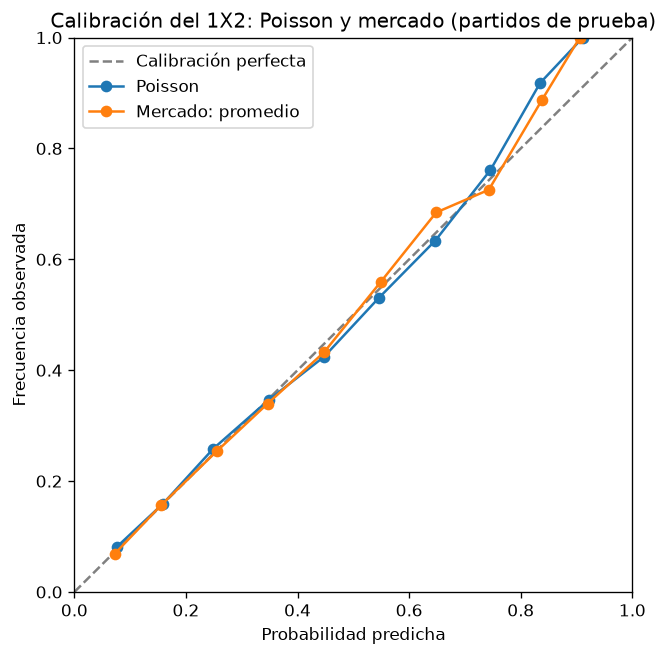

# Modelo de goles: Poisson independiente

Generado por `python scripts/evaluate_poisson.py`. No editar a mano.

- **Datos:** 4180 partidos, temporadas 2015/16 a 2025/26.
- **Temporadas de prueba:** 2018/19 a 2025/26 (8 temporadas, 3040 partidos), con la misma ventana expansiva que los baselines.
- **Poisson:** cada equipo tiene una fuerza de ataque y una de defensa, más una ventaja de local común. Los goles de cada equipo se suponen Poisson e independientes. El modelo se reajusta en cada fecha con todos los partidos anteriores, todos con el mismo peso. Penalización = 10, valor fijo sin ajustar.
- **Elo fijo:** K = 20, ventaja de local = 60.
- **Mercado:** promedio de las casas, con el margen removido (normalización proporcional).
- En todas las métricas, menos es mejor.
- **Conclusión:** en 1X2 este Poisson queda por debajo del Elo fijo en las tres métricas, así que todavía no cumple el criterio de éxito de la especificación. En más/menos de 2.5 mejora poco a la frecuencia histórica.
- **Limitaciones:** todos los partidos pasados pesan igual, por antiguos que sean; por eso el modelo empeora frente al Elo a medida que acumula historia y falla con equipos cuyo nivel cambió (por ejemplo, ascendidos que ya habían estado en la liga años atrás). Un equipo sin ningún partido previo empieza como equipo promedio. Tampoco tiene todavía la corrección de Dixon-Coles para marcadores bajos.

## Resultado 1X2 (los 3040 partidos de prueba juntos)

| Modelo | Log loss | Brier | RPS |
|---|---|---|---|
| Frecuencias históricas | 1.0675 | 0.6461 | 0.2342 |
| Elo fijo | 0.9786 | 0.5807 | 0.2025 |
| Poisson | 0.9907 | 0.5899 | 0.2075 |
| Mercado: promedio | 0.9584 | 0.5680 | 0.1965 |

## Más/menos de 2.5 goles (los 3040 partidos de prueba juntos)

En los partidos de prueba hubo más de 2.5 goles en el 54.8% de los casos.

| Modelo | Log loss | Brier |
|---|---|---|
| Frecuencia histórica | 0.6892 | 0.4960 |
| Poisson | 0.6841 | 0.4910 |
| Mercado: promedio | 0.6755 | 0.4826 |

## Goles esperados contra goles reales

| Equipo | Goles esperados (promedio) | Goles reales (promedio) |
|---|---|---|
| Local | 1.5436 | 1.5530 |
| Visitante | 1.2412 | 1.3059 |

## Log loss por temporada de prueba: 1X2

| Temporada de prueba | Frecuencias históricas | Elo fijo | Poisson | Mercado: promedio |
|---|---|---|---|---|
| 2018/19 | 1.0469 | 0.9061 | 0.9032 | 0.8936 |
| 2019/20 | 1.0645 | 0.9852 | 0.9712 | 0.9726 |
| 2020/21 | 1.0890 | 1.0506 | 1.0256 | 1.0042 |
| 2021/22 | 1.0695 | 0.9524 | 0.9516 | 0.9360 |
| 2022/23 | 1.0510 | 0.9841 | 1.0188 | 0.9658 |
| 2023/24 | 1.0540 | 0.9261 | 0.9419 | 0.9093 |
| 2024/25 | 1.0811 | 0.9830 | 1.0552 | 0.9706 |
| 2025/26 | 1.0838 | 1.0415 | 1.0579 | 1.0153 |

## Log loss por temporada de prueba: más/menos de 2.5 goles

| Temporada de prueba | Frecuencia histórica | Poisson | Mercado: promedio |
|---|---|---|---|
| 2018/19 | 0.6906 | 0.7003 | 0.6846 |
| 2019/20 | 0.6924 | 0.6631 | 0.6650 |
| 2020/21 | 0.6947 | 0.7008 | 0.6910 |
| 2021/22 | 0.6906 | 0.6707 | 0.6815 |
| 2022/23 | 0.6918 | 0.6819 | 0.6692 |
| 2023/24 | 0.6793 | 0.6868 | 0.6477 |
| 2024/25 | 0.6859 | 0.6868 | 0.6774 |
| 2025/26 | 0.6883 | 0.6827 | 0.6873 |

## Calibración del 1X2

Se juntan las tres probabilidades de cada partido y se agrupan en tramos de 10 puntos. `predicho` es la probabilidad promedio del tramo y `observado` la frecuencia con la que el resultado ocurrió.

### Poisson

| Tramo | n | predicho | observado |
|---|---|---|---|
| 0.0 a 0.1 | 222 | 0.0758 | 0.0811 |
| 0.1 a 0.2 | 1343 | 0.1590 | 0.1593 |
| 0.2 a 0.3 | 3623 | 0.2492 | 0.2586 |
| 0.3 a 0.4 | 1298 | 0.3488 | 0.3467 |
| 0.4 a 0.5 | 1070 | 0.4475 | 0.4243 |
| 0.5 a 0.6 | 734 | 0.5452 | 0.5300 |
| 0.6 a 0.7 | 500 | 0.6470 | 0.6340 |
| 0.7 a 0.8 | 268 | 0.7457 | 0.7612 |
| 0.8 a 0.9 | 61 | 0.8347 | 0.9180 |
| 0.9 a 1.0 | 1 | 0.9113 | 1.0000 |

### Mercado: promedio

| Tramo | n | predicho | observado |
|---|---|---|---|
| 0.0 a 0.1 | 379 | 0.0720 | 0.0686 |
| 0.1 a 0.2 | 1478 | 0.1559 | 0.1570 |
| 0.2 a 0.3 | 3407 | 0.2552 | 0.2539 |
| 0.3 a 0.4 | 1306 | 0.3466 | 0.3400 |
| 0.4 a 0.5 | 902 | 0.4475 | 0.4324 |
| 0.5 a 0.6 | 702 | 0.5495 | 0.5598 |
| 0.6 a 0.7 | 485 | 0.6485 | 0.6845 |
| 0.7 a 0.8 | 317 | 0.7428 | 0.7256 |
| 0.8 a 0.9 | 142 | 0.8379 | 0.8873 |
| 0.9 a 1.0 | 2 | 0.9058 | 1.0000 |
